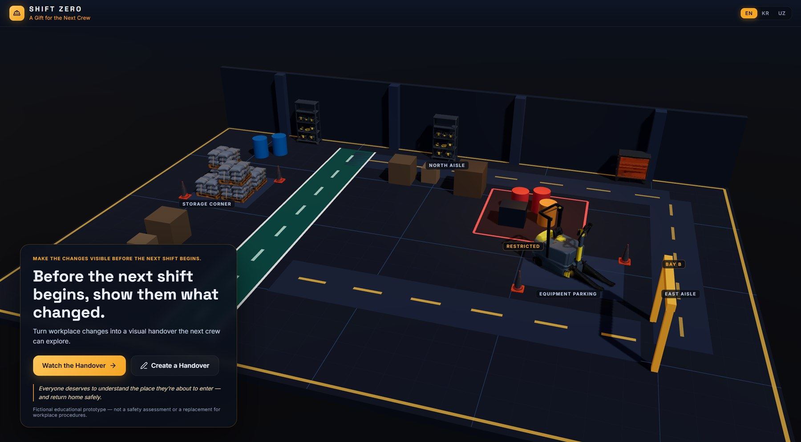
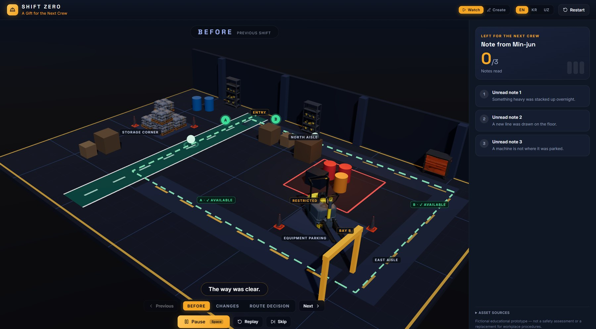
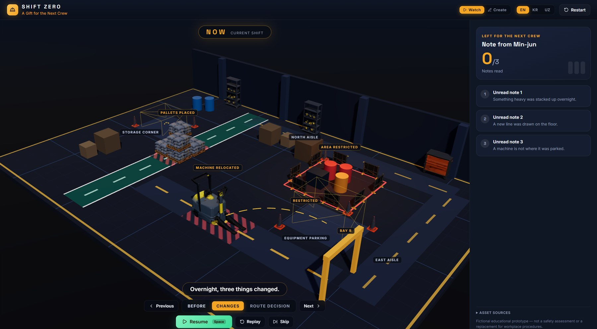
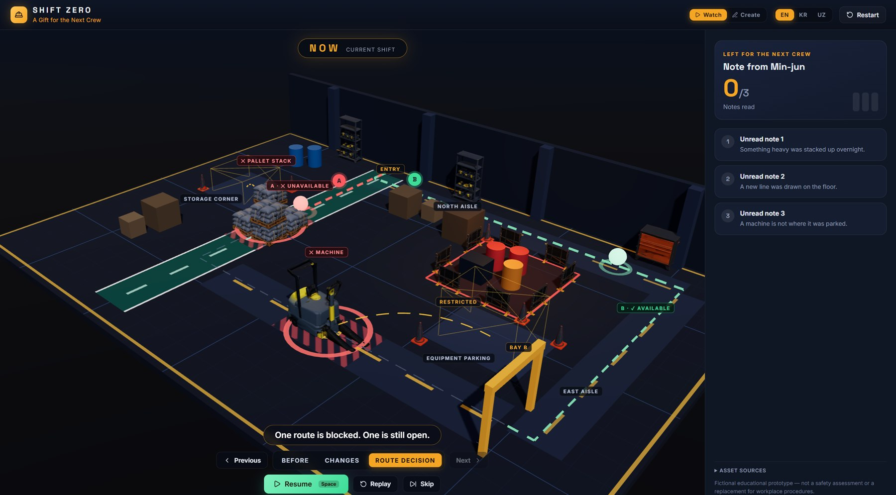
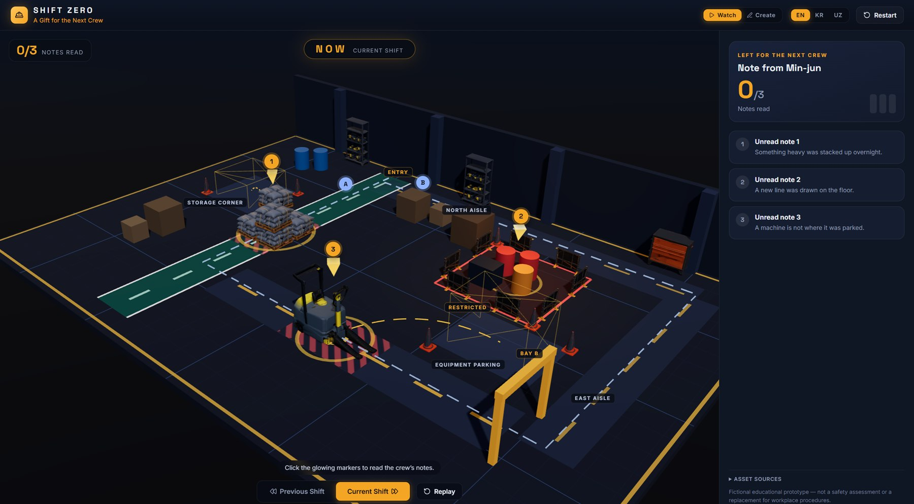
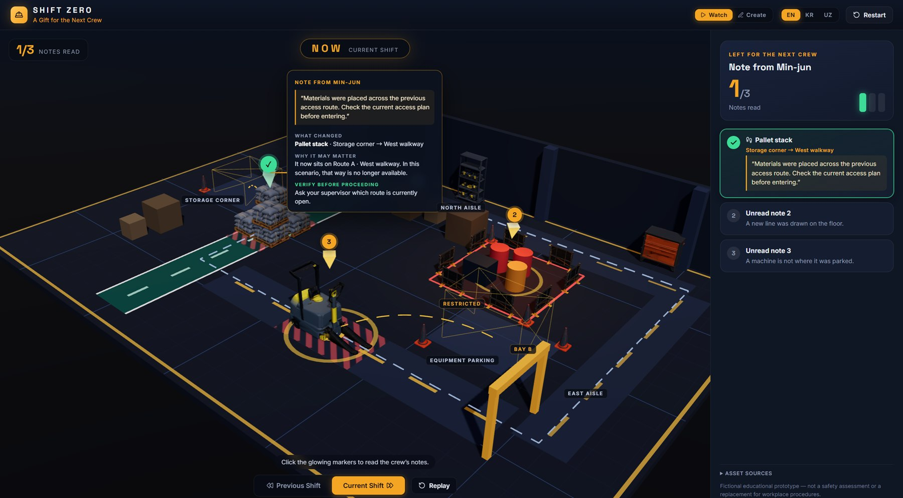
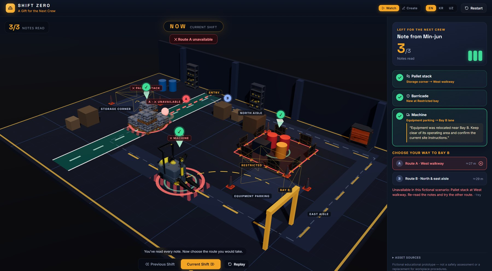
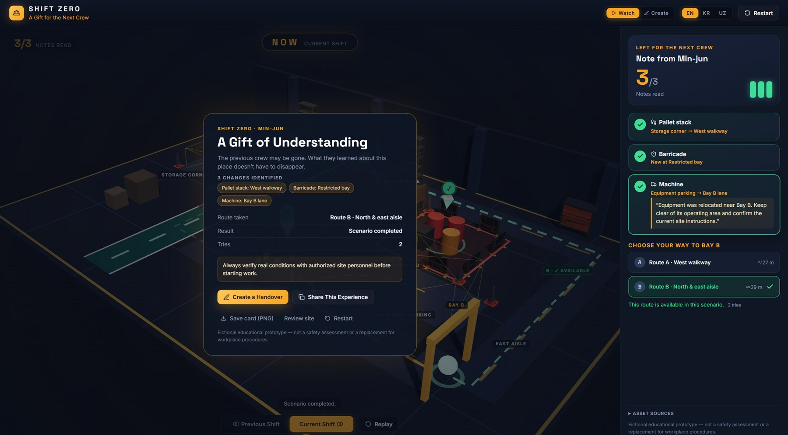
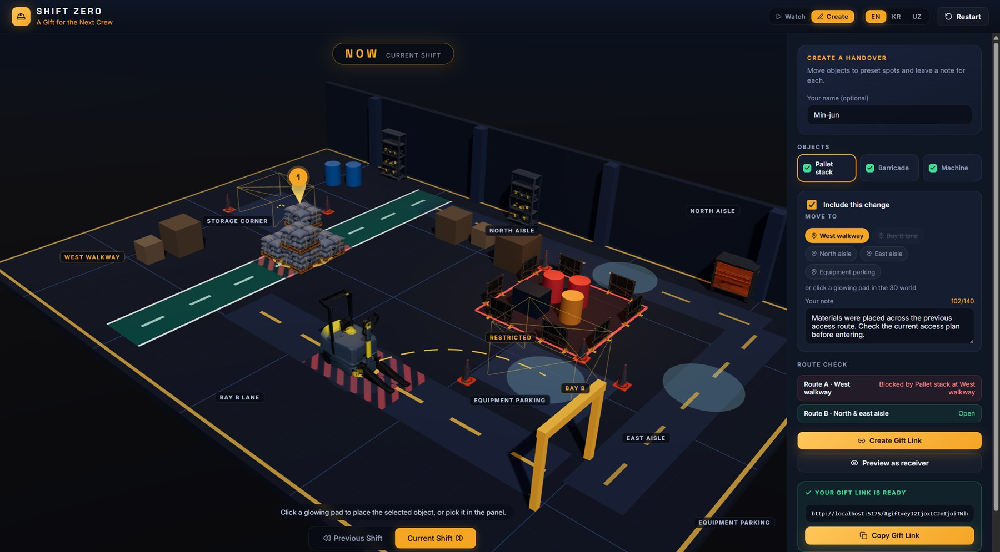

<div align="center">

# SHIFT ZERO
### A Gift for the Next Crew

**Before the next shift begins, show them what changed.**

Turn workplace changes into a visual handover the next crew can explore, in real-time 3D, right in the browser.

*Built for Tripothon S1 Seoul* · English · 한국어 · Oʻzbekcha



</div>

> *Everyone deserves to understand the place they're about to enter — and return home safely.*

> **Fictional educational prototype.** It is not a safety assessment and not a replacement for workplace procedures. The scenario is invented and not based on any real incident.

---

## What it does

The outgoing crew leaves a **gift**: which objects moved, a short note for each, and what it may mean for the routes in. The incoming crew opens a link and sees the site **before**, then **now**, then makes a **route decision**.

| | |
|---|---|
| **See** | A guided 12-second 3D showcase: BEFORE, CHANGES, ROUTE DECISION |
| **Understand** | Each change has a note: *what changed · why it may matter · what to verify before proceeding* |
| **Decide** | Pick a route. A light walks it and stops where it is blocked |
| **Create & share** | Build your own handover and share it as a single link. No server, no account |

---

## The guided showcase

Press **Watch the Handover** and the live 3D site tells the story on its own.

### 1 · BEFORE: *"The way was clear."*
Both routes are open and the site looks as the previous crew left it.



### 2 · CHANGES: *"Overnight, three things changed."*
The pallets, the restricted area and the relocated machine are called out right on the objects.



### 3 · ROUTE DECISION: *"One route is blocked. One is still open."*
Route A turns red where the pallets now sit. Route B stays green.



**Presenter controls** sit at the bottom of the screen throughout: **Pause / Resume** (or press `Space`), **Previous / Next** phase, **Replay** and **Skip**. Pausing freezes all showcase motion and resuming continues from the same point.

---

## Then explore it yourself

Orbit the site with the mouse and click the glowing markers.



Each marker opens a briefing attached to the object in 3D. It gives the crew's note, what changed, why it may matter, and what to verify before proceeding.



Once every note is read, choose your route. Pick the blocked one and the walker stops at the obstruction.



Pick the open route to finish: **A Gift of Understanding**.



---

## Create a handover

Anyone can leave a gift. Pick an object, click a glowing pad to move it, and write a note. A live **route check** shows how your change affects each route. Press **Create Gift Link**, or **Preview as receiver** to see exactly what the next crew will see.



A gift lives entirely inside the link (the URL hash, `#gift=…`). Nothing is uploaded, and anyone with the link sees the same handover.

---

## Run it

```bash
npm install
npm run dev        # open the URL it prints (usually http://localhost:5173)
```

For a production build: `npm run build`, then `npm run preview`.

No account, backend, API key or internet connection is needed. Everything runs in the browser.

## 60-second demo script

1. Click **Watch the Handover** and let the showcase play. Pause with `Space` to talk over any moment.
2. Click **Skip**, then open the three glowing markers and read the briefings.
3. Choose **Route A** (blocked), then **Route B** (open) to reach the ending.
4. Click **Create a Handover**, change something, press **Create Gift Link**, then **Preview as receiver**.
5. Switch language at any time (top right): **EN / KR / UZ**.

## 3D assets and credit

The six objects (pallet, barrier, machine, traffic cone, storage rack, tool cabinet) are static `.glb` models in `public/models/`.

- The team declares them as **pre-generated in Tripo Studio**. The app cannot verify this itself, and the in-app **Asset sources** panel says so.
- **No live Tripo API calls are made.**
- If a model fails to load, the app falls back to simple built-in shapes, so the scene never goes blank.
- Textures were downscaled from 8192² to 2048² (`scripts/shrink-glb-textures.mjs`) so the page loads quickly. Geometry and materials are unchanged. Full-size originals are kept in `assets-original/models/`.

## Tech

Vite · React 19 · TypeScript · three.js · @react-three/fiber · @react-three/drei · lucide-react · plain CSS.

## Project layout

| Path | What it is |
|---|---|
| `src/App.tsx` | App shell, guided showcase, presenter controls |
| `src/Scene.tsx` | The 3D worksite, routes, markers and camera |
| `src/showClock.ts` | Shared animation clock that makes pause truly freeze motion |
| `src/TripoAsset.tsx` | One-time GLB loading with procedural fallback |
| `src/Receive.tsx` / `src/Create.tsx` | Receiver and creator panels |
| `src/handover.ts` | Anchors, routes, gift link encoding and validation |
| `src/i18n.ts` | English / Korean / Uzbek text |
| `public/models/` | The six GLB models |
| `docs/screenshots/` | Images used in this README |
